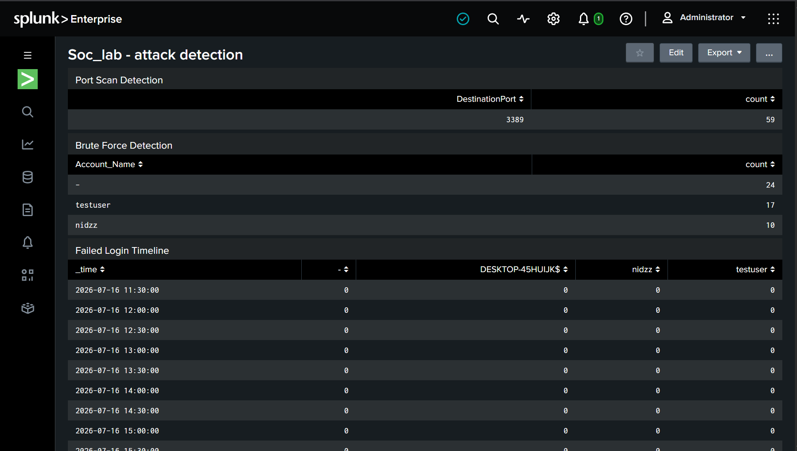
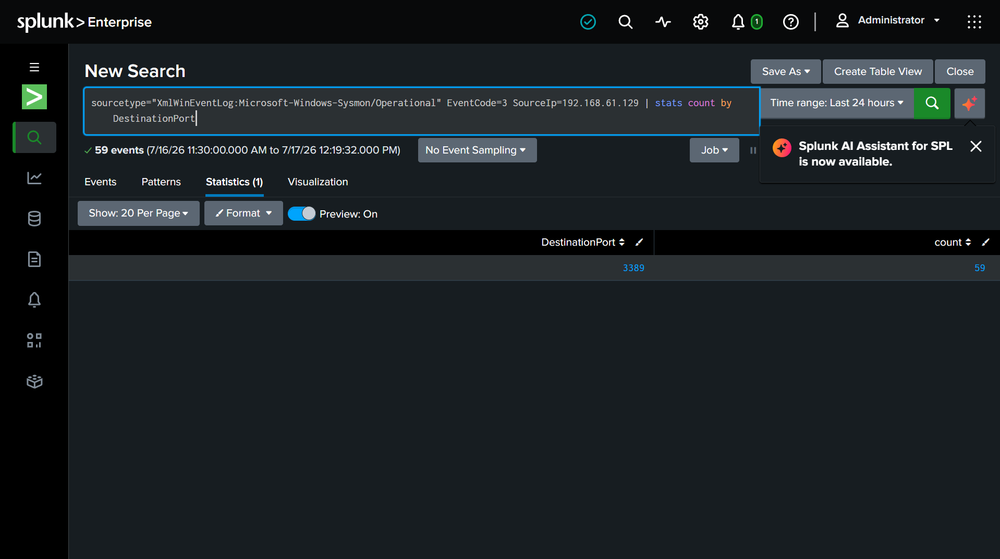
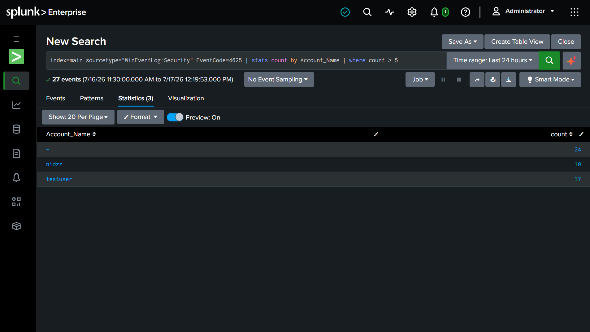

# Soc-home-lab
# SOC Home Lab — SIEM & Endpoint Detection Engineering

### Splunk SIEM · Attack Simulation · Threat Detection

A self-built Security Operations Center home lab simulating real-world attacks and detecting them with Splunk. The lab chains an isolated virtual network, a monitored Windows endpoint, an attacker VM, and a SIEM into one environment to practice the full attack-detect lifecycle hands-on.

---

## Dashboard

**SOC Lab Dashboard** — port scan detection, brute force detection, and failed login timeline, live from real attack traffic


**Port Scan Detection Query** — live SPL query and results


**Brute Force Detection Query** — live SPL query and results


---

## Architecture

```
┌─────────────────┐        ┌─────────────────┐        ┌──────────────────┐
│   KALI LINUX    │        │   WINDOWS 10    │        │  SPLUNK (HOST)   │
│  192.168.61.129 │──────▶ │  192.168.61.130 │──────▶ │  192.168.61.1    │
│                 │ ATTACK │                 │  LOGS  │                  │
│ • Nmap          │        │ • Sysmon        │  :9997 │ • SIEM           │
│ • Hydra         │        │ • UF Forwarder  │        │ • SPL Detections │
└─────────────────┘        └─────────────────┘        └──────────────────┘

              VMware NAT Network · 192.168.61.0/24 · Single-host lab
```

---

## Endpoint Telemetry

| Component | Configuration | Purpose |
|---|---|---|
| Splunk Universal Forwarder | `outputs.conf` → 192.168.61.1:9997 | Ships Windows Event Logs to Splunk |
| Sysmon | olafhartong modular config | Deep endpoint visibility — default config was insufficient, missed network connection logging (EventCode 3) |

**Sysmon event codes captured:** 1 (process creation), 3 (network connection), 7 (DLL load), 10 (process access), 11 (file creation), 22 (DNS query)

---

## Detection Modules

| Module | Source | Description |
|---|---|---|
| Port Scan Detection | Sysmon EventCode 3 | Flags connection attempts from the attacker IP grouped by destination port |
| Brute Force Detection | Security EventCode 4625 | Flags accounts with 5+ failed logons |
| Failed Login Timeline | Security EventCode 4625 | Timechart of failed logons per minute, per account |

---

## SPL Detection Rules

### Port Scan Detection
```spl
sourcetype="XmlWinEventLog:Microsoft-Windows-Sysmon/Operational" EventCode=3 SourceIp=192.168.61.129
| stats count by DestinationPort
```

### Brute Force Detection
```spl
index=main sourcetype="WinEventLog:Security" EventCode=4625
| stats count by Account_Name
| where count > 5
```

### Failed Login Timeline
```spl
index=main sourcetype="WinEventLog:Security" EventCode=4625
| timechart span=1m count by Account_Name
```

---

## Attack Simulations

| Attack | Tool | Target | Result |
|---|---|---|---|
| Port scan / recon | Nmap (`nmap -sV`) | Windows 10 (192.168.61.130) | 1,000 ports scanned; all filtered by Windows Firewall |
| RDP brute force | Hydra (`fasttrack.txt` / `rockyou.txt`) | Windows 10 RDP :3389 | 10+ failed logons (`nidzz`), 17+ failed logons (`testuser`) |

**Note:** Hydra's RDP module initially failed with connection errors even after RDP was confirmed reachable (verified manually via `xfreerdp`). Root cause: the module is marked experimental and struggles with parallel connections/NLA. Fixed by tuning to single-threaded with a connection delay: `-t 1 -W 3`.

---

## MITRE ATT&CK Mapping

| Observed Behavior | Technique | ID | Reasoning |
|---|---|---|---|
| Nmap scan, 1,000 ports against Windows VM | Network Service Discovery | [T1046](https://attack.mitre.org/techniques/T1046/) | Broad port scanning to enumerate services, regardless of results, is discovery-phase behavior. |
| 10-17+ failed RDP logins via Hydra against fixed accounts | Brute Force | [T1110](https://attack.mitre.org/techniques/T1110/) | Repeated automated login attempts against fixed usernames with a wordlist is direct evidence of password-guessing. |
| RDP (Logon Type 10, Remote Interactive) targeted specifically | External Remote Services | [T1133](https://attack.mitre.org/techniques/T1133/) | RDP is a common initial-access vector; direct targeting reflects an attempt at remote interactive access. |

---

## Results

| Metric | Value |
|---|---|
| Total events indexed | 5,000+ |
| Sysmon events (initial capture) | 962, growing |
| Failed logins detected | 27 total (10 `nidzz` + 17 `testuser`) |
| Unique ports scanned | 1,000 |
| Detection queries built | 3 |
| Dashboard panels | 4 |
| Attack simulations run | 2 |

---

## Tools & Technologies

| Category | Tool |
|---|---|
| SIEM | Splunk Enterprise |
| Hypervisor | VMware |
| Attacker OS | Kali Linux |
| Target OS | Windows 10 |
| Endpoint Monitor | Sysmon (olafhartong config) |
| Brute Force | Hydra |
| Recon | Nmap |

---

## Challenges & Resolutions

| Challenge | Root Cause | Resolution |
|---|---|---|
| Sysmon EventCode 3 missing from logs | Default Sysmon config excludes network connection logging | Deployed the olafhartong modular Sysmon config |
| Hydra RDP brute force failed with connection errors | RDP module is experimental; struggles with parallel connections/NLA | Reduced to single-threaded, delayed attempts (`-t 1 -W 3`) |
| RDP unreachable via Hydra initially | RDP service disabled by default on Windows 10 | Enabled via registry (`fDenyTSConnections=0`) |

---

## Key Takeaways

- Built and configured a real SIEM pipeline from raw endpoint logs to working detections
- Practiced the full attack → log → detect lifecycle hands-on, both attacker and defender side
- Diagnosed and fixed a real tool-level failure (Hydra's RDP module) by isolating variables rather than guessing
- Learned to separate real attack signal from background log noise (e.g. unrelated 4625 events under a blank account)

---

## Possible Extensions

- Deploy an Active Directory domain (GOAD / BadBlood) to simulate enterprise attack paths (Kerberoasting, Pass-the-Hash)
- Add automated Splunk alerting instead of manual query execution
- Add a credential-stuffing detection (failures followed by a success) for more advanced correlation

---

## About

Built as part of a cybersecurity portfolio. All attacks were performed inside an isolated VMware NAT lab with no external network exposure.

**Skills:** `Splunk` `SIEM` `SPL` `Blue Team` `SOC` `Detection Engineering` `Nmap` `Hydra` `Kali Linux` `Windows Event Logs` `Sysmon` `MITRE ATT&CK`
